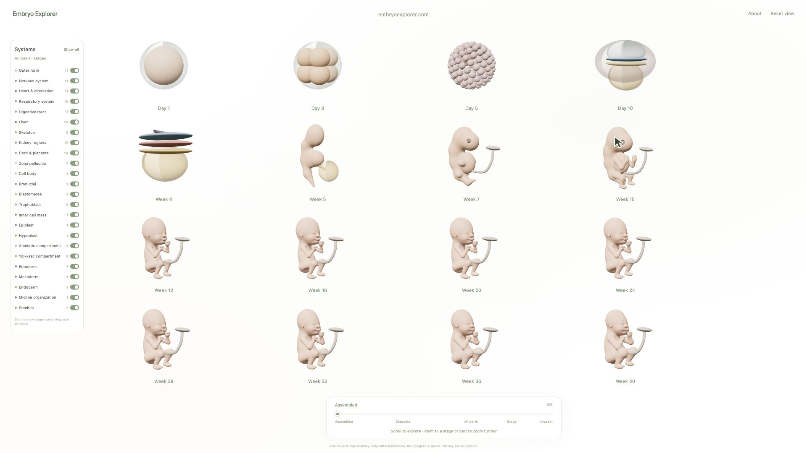

# Embryo Explorer

We recently launched the [Virtual Embryo Challenge on Yukon](https://yukon.org/virtualembryo). I knew nothing about embryos, so I used ChatGPT Astra to build a 3D embryo explorer and see how development works.

The challenge brings researchers and AI agents together to build predictive models of embryonic development, using the [Stanford Qiu Lab-led challenge](https://www.devo-evo.com/papers/virtual_embryo_challenge/)’s dataset of roughly one million mouse cells across 11 developmental time points. This explorer is my way of learning about **human development**, from fertilization to pregnancy week 40.

Credit to [Ash (@ashebytes)](https://x.com/ashebytes) and her [Human Atlas](https://github.com/ashemag/human-atlas) for inspiring the fluid 3D navigation and the idea of learning by taking anatomy apart.

**[Explore the website](https://embryoexplorer.com/) · [Watch the 20-second demo with music](media/embryo-explorer-walkthrough-with-music.mp4)**

[](https://embryoexplorer.com/)

## Explore

Start with all sixteen stages on one screen. Move the bottom slider or scroll to separate the anatomy, spread out its parts, and zoom into a stage or structure. Click a part for its explanation, drag to rotate, and use the Systems panel to select or hide structures. Reset returns to the full overview.

## Run locally

```sh
git clone https://github.com/pratikgx/embryo-explorer.git
cd embryo-explorer
python3 -m http.server 8873 --directory dist
```

Open [localhost:8873](http://localhost:8873). No build step is needed; Three.js is bundled locally. Serve `dist/` with any static web server. JavaScript modules need HTTP rather than opening the HTML file directly.

## What the models represent

These are original, schematic illustrations of human development. Early labels use days after fertilization; later labels use pregnancy weeks. Stage snapshots, anatomy and transitions are simplified, and parts are resized for inspection. The explorer does not use the challenge’s mouse dataset or predict development. It has not received specialist anatomical validation and is not intended for clinical use.

The [anatomy matrix](dist/anatomy-matrix.md) lists stage-specific sources and limitations. [Verification notes](VERIFICATION.md) document the interaction checks and remaining gaps.

## Inside the repository

- [`dist/`](dist/): the browser app, stage descriptions, generated anatomy and bundled Three.js.
- [`scripts/prenatal_geometry.py`](scripts/prenatal_geometry.py): the original body-surface generator; requires NumPy, SciPy and scikit-image.
- [`scripts/video/`](scripts/video/): walkthrough capture and music-edit instructions.
- [`media/`](media/): the current demo with music, a silent version and earlier guided films.
- [`docs/development-history.md`](docs/development-history.md): implementation notes from earlier versions.

## Credits and license

Built by Pratik Gandhi with ChatGPT Astra. The geometry and interface were created for this project; Human Atlas inspired the interaction, and its models and imagery are not included.

Demo music: [“Calm Ambient Science Medical Tech” by Musinova](https://pixabay.com/music/corporate-calm-ambient-science-medical-tech-362424/), used under the [Pixabay Content License](https://pixabay.com/service/license-summary/).

The project’s original code, documentation and generated anatomy are available under the [MIT License](LICENSE). Three.js retains its [MIT notice](dist/vendor/LICENSE.txt). The demo soundtrack remains under the Pixabay Content License and is excluded from this repository’s MIT grant. See [third-party notices](THIRD_PARTY_NOTICES.md) and [asset credits](dist/CREDITS.txt).

Corrections and contributions are welcome. See [CONTRIBUTING.md](CONTRIBUTING.md), especially for changes to anatomy or developmental descriptions.
